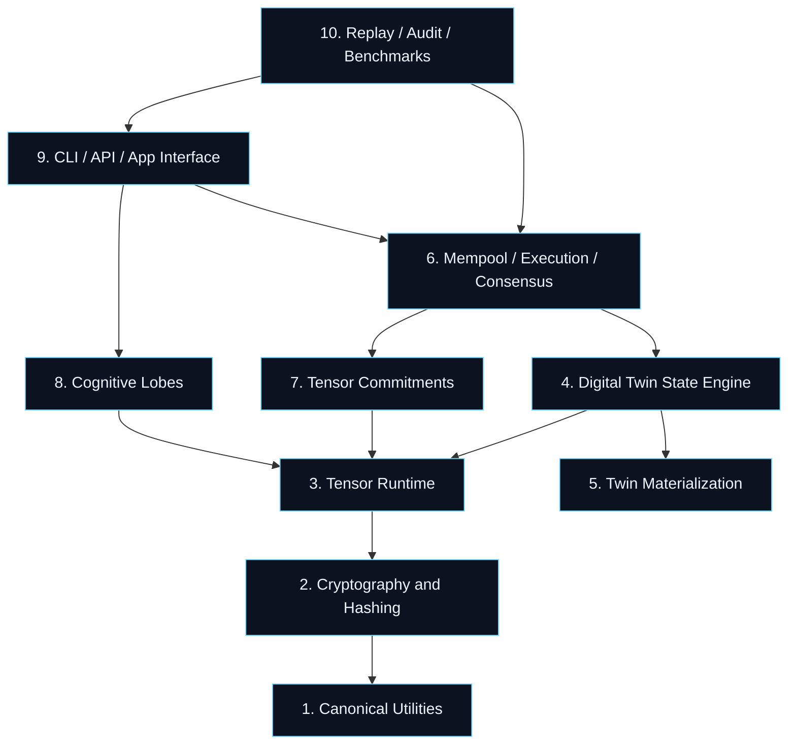

# Tensorized Blockchain Architecture

This document describes the architectural layers of the **Tensorized Blockchain** stack, a prototype distributed-ledger substrate combining cryptographic commitments with tensor-network state representation.

## Architecture Layers

### 1. Canonical Utilities
- **`tb_config.py`**: Shared configuration, versions, safety policies, and constraint budgets.
- **`tb_canonical.py`**: Deterministic JSON-safe data serialization, sorting, and byte encoding to ensure platform-independent hashing.
- **`tb_observability.py`**: Structured diagnostics, logging formatters, and environment health checks.

### 2. Cryptography and Hashing
- **`tb_hashing.py`**: Domain-separated SHA-256 leaf/node hashing and Merkle tree generation/verification.
- **`tb_crypto.py`**: Public-key cryptography using Ed25519 signing and verification keys.
- **`tb_schemas.py`**: Standardized dataclass declarations for transaction envelopes, consensus votes, and receipts.
- **`tb_validation.py`**: Strict invariant validators checking block topology, cryptographic signatures, and state transition metadata.
- **`tb_security.py`**: Threat-prevention filters, memory-boundary guards, and private key checking.
- **`tb_storage.py`**: Path-safe, atomic disk storage with sidecar JSON integrity manifests.

### 3. Tensor Runtime
- **`tn.py`**: High-performance, CPU-first Tensor Train / Matrix Product State (MPS) and Tucker tensor network runtime. Handles SVD rounding, contractions, and norm calculations.

### 4. Digital Twin State Engine
- **`digital_twin_kernel.py`**: Implements the Tree Tensor Network topology, state sketches, and policy-gated action approvals.

### 5. Twin Materialization
- **`twin_anything.py`**: Universal factory producing Digital Product Passport (DPP) twin trees for physical edge assets (e.g., quadruped rescue robots).

### 6. Mempool, Execution, and Consensus
- **`tb_mempool.py`**: Handles incoming transactions, enforces sequencing/replay protection, and deterministic batching.
- **`tb_execution.py`**: Executes transaction actions on twin state, comparing pre/post state roots and recording execution receipts.
- **`tb_consensus.py`**: Quorum consensus logic, signature aggregation, and transition certificates.

### 7. Tensor Commitments
- **`tb_tensor_commitments.py`**: Maps high-dimensional Tensor Train cores and compression metrics into ledger block commitments.

### 8. Cognitive Lobes
- **`ncp.py`**: Liquid Reflex Lobe backed by Neural Circuit Policies for recurrent stabilization.
- **`cfc.py`**: Predictive Transition Lobe backed by Closed-form Continuous-time models for forecasting.
- **`cognitive_lobe_runtime.py`**: Coordinates NCP and CfC substrates, feeding features and collecting lobe receipts.
- **`lobe_scaler.py`**: Governs elastic capacity scaling up to a 2.5B parameter budget constraint.

### 9. CLI, API, and App Interfaces
- **`tb_cli.py`**: Production command-line interface.
- **`tb_api.py`**: Programmatic FastAPI REST server exposing Swagger docs.
- **`app.py`**: Cinematic dark-themed Streamlit demo cockpit.

### 10. Replay, Audit, and Benchmarks
- **`tb_replay.py`**: Deterministic block-by-block replay and forensic validation tool.
- **`tb_open_source_audit.py`**: Open-source release sanity check.
- **`tb_benchmarks.py`**: Experimental harness for contraction and compression profiles.
